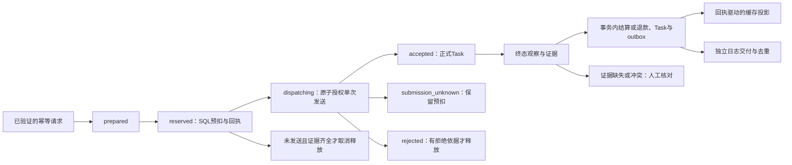

# P2-A1 增量结构审查（2026-11-07）

最新状态：第三批已收齐A1只读审查覆盖和候选清单，最终文档交付按本提交对应完整CI读取；产品修复、故障反例和真实验收分别保留，以下前两批未完成状态是历史时点。

基线：dev / `f46f19c71dbf6954620feb43c01b8d8aa87bb1d5`。本文接续原 architecture-review.md。首批核对Lite支付回调、仅外部登录账户的访问能力；第二批基线dev/`4e42f4939422e8a7f04de4f6f50ce102dd77ed21`，接续异步任务恢复与账务衔接，具体覆盖见各节。主代理只读源码，没有运行行为测试、访问生产、查询真实账户或订单，也没有发送邮件、支付或模型请求。下表均为**从代码看**，不是新运行回归的结论。

## 本次结论

Full→Lite 不能当作普通镜像更新直接执行：回调路径会改变可达性，无密码账户也可能失去下一次登录入口。当前 Full→Full 的 beta.34→beta.36 打包不改变 edition，不需要为它扩大为降级修复。签名校验、资金 mode/epoch 与订单匹配仍必须保留，不能为恢复回调可达性而删门禁。

| ID | 从代码看 | 直接依据（本轮已读对应段落） | 影响与后续验收 |
| --- | --- | --- | --- |
| A1-01 | EditionGuard 在业务路由注册之前安装；Full 直接继续，Lite/lan 按路径阻断 | `main.go:203`、`middleware/edition.go:88` | 本文 Lite 路径结论不应推成 Full 当前线上失败；真实线上行为未测 |
| A1-02 | Stripe、Creem、Waffo webhook、Epay 充值 notify 和订阅 notify/return 被 Lite 前缀匹配提前返回403；签名及订单处理器还未执行 | `middleware/edition.go:131`、`:163`；`router/api-router.go:78`、`:98`、`:213` | 有未完成订单时直接降级可能切断履约；待合成真实路由回归，不联系供应商或重放现有通知 |
| A1-03 | `/api/waffo-pancake/webhook/:env` 不匹配 `/api/waffo` 加斜杠的前缀规则，且没有独立 Pancake 项；其可达性与其他提供方不同 | `router/api-router.go:83`、`middleware/edition.go:142`、`:163` | 这是版本路径差异，不能据此声称无签名可充值或直接封掉已付订单；下一轮统一降级策略后再决定处理方式 |
| A1-04 | Pancake 处理器仍检查test/prod、已配置签名、事件mode/type，再做资金决策；结算仍按订单种类分别处理 | `controller/topup_waffo_pancake.go:465`、`:476`、`:482`、`:487`、`:541` | 不把路径差异写成资金授权绕过；这些门禁必须由后续合成回归保持 |
| A1-05 | 资金策略与 edition 是不同维度；disabled 确认但不结算，retirement 只允许截止 epoch/ID 内历史订单，enabled 仍要求提供方、pending状态和epoch匹配 | `service/user_funding_policy.go:28`、`:74`；`model/user_funding_policy.go:381`、`:402` | 仅放行HTTP路径不足以证明会入账；也不能因禁购买而把retirement改成disabled、清空订单或放宽资金校验 |
| A1-06 | 订阅/充值的资金决策会在事务中重新校验，订阅订单使用跨库lockForUpdate并校验支付提供方与状态 | `model/subscription.go:632`、`:645`、`:651`、`:660`；`model/topup.go:326`、`:332`、`:341` | 后续 A2 必须保事务、状态、幂等及精确单次入账；本轮未审完整个结算子系统，不声称三库新行为已验 |
| A1-07 | 外部OAuth新用户从空User开始，不填密码；InsertWithTx允许空密码，插入默认设置及初始额度，不自动生成本地登录密码 | `controller/oauth.go:292`、`:333`、`:370`；`model/user.go:665`、`:674`、`:775`、`:132`；`model/credit_edge.go:100` | 无密码账户是实际支持的创建路径；不能假定每个外部登录用户已有本地凭据 |
| A1-08 | Lite封 `/api/oauth`；密码登录虽可达，还受PasswordLoginEnabled控制，空存储密码明确拒绝 | `middleware/edition.go:139`；`router/api-router.go:66`、`:75`、`:94`；`controller/user.go:40`；`model/user.go:1105`、`:1125` | 缺本地密码及可用Passkey时，重新登录可能不可达。此结论不表示现有会话立即失效；本轮未审所有会话续期路径 |
| A1-09 | Passkey登录不在Lite禁止前缀中，但需要开关/WebAuthn环境及已注册凭据；有API路径不能证明用户实际拥有可用凭据 | `router/api-router.go:95`；`controller/passkey.go:299`、`:309`、`:382`；`middleware/edition.go:131` | 降级前应实际确认所需账户的本地登录能力，不得仅以全局开关或凭据条数替代用户能登录的证明；浏览器/认证器未验 |
| A1-10 | 个人改密检查会拒绝旧密码为空；邮箱重置另有保留路径，通过唯一邮箱与重置码更新密码并撤销会话 | `controller/user.go:923`、`:934`；`router/api-router.go:63`、`:64`；`controller/misc.go:301`、`:334`；`model/user.go:1253` | 不能笼统建议无密码用户“在个人资料直接设密码”，也不能说邮箱恢复不存在；邮件投递、邮箱唯一性、密码登录开关及恢复后登录仍须确认，未发邮件 |
| A1-11 | CLI升级以已有.env中的edition选镜像并校验配置；该计划构造没有检查数据库pending订单或逐账户凭据。安装器既有保护主要核对目标身份和batch配置；受限运维服务仅支持Full | `cli/myapi.mjs:1183`、`:1190`、`:1197`；`deploy/install.sh:303`、`:314`；`tools/operations/docker.mjs:86` | 不把P1来源预检当作Full→Lite业务降级预检。受限运维服务不应扩展为Lite切换，本次也不安装它 |

## 第二批：异步任务恢复与账务衔接（2026-11-07，只读）

成功标准：把真实HTTP入口、系统任务调度、预扣/发送/终态、资金回执、缓存投影和日志交付串起来，区分已核对机制与待复现问题。验证方法：主代理亲读以下实现与调用点；本批只改文档，不新建行为测试，不将基线CI或文档CI当作新反例已复现。未调用生产、模型、供应商或恢复/重放入口。

### 状态与责任边界（均从代码看）



此图只表达本批已追踪的主要分支，不是完整状态机；未知状态的后续provider_verified/manual_audit解析、旧版非durable路径仍有独立条件。恢复SQL/日志投影不等于重新发送上游模型请求。

| ID | 从代码看 | 本轮亲读依据 | 结论的边界 |
| --- | --- | --- | --- |
| A1-12 | durable HTTP入口需要新提交开关、受支持的任务种类及幂等头，其他请求仍可走原任务路径 | `controller/relay.go:632`；`controller/relay_task_durable.go:26` | 不能把durable保护宣称成全部异步任务默认都有；本轮未逐个审完provider适配器 |
| A1-13 | 规范幂等头只接受单值、可打印有界ASCII；别名/下划线变体拒绝，hash后去掉原头。意图以Token/方法/种类/hash唯一化；重复owner=false直接返回旧操作，不再进发送pipeline | `service/task_submission_protocol.go:49`、`:109`；`service/task_ingress_service.go:150`、`:189`、`:208`；`model/task_recovery.go:651`、`:1190` | 正文fingerprint计算器只追到调用点，本轮未完整审JSON/表单/多媒体规范化，不能代替碰撞/等价性审查 |
| A1-14 | 新提交与已有义务恢复独立开关，schema兼容始终开启；开启任一运行能力要求专用幂等secret及DB单例身份；已有operation但身份缺失时不自动重绑 | `common/init.go:153`、`:165`；`common/constants.go:175`、`:182`、`:195`；`model/main.go:194`；`model/task_recovery_identity.go:50` | 不改现网开关、secret或identity，不以换配置重建历史幂等身份；未核对真实部署值 |
| A1-15 | main注册controller handlers后启动Master系统任务；恢复与日志outbox分别注册，由Enabled决定是否排新周期行，系统任务租约/heartbeat处理claim和失联 | `main.go:161`、`:163`；`controller/system_task_handlers.go:24`、`:343`、`:384`；`service/system_task.go:138`、`:279`、`:320`、`:369` | 已找到实际调用，不能因runner不在service里直接调用就判“没有接线”；排队后gate复核仍见R1 |
| A1-16 | pipeline拒绝外部已开事务；T1预扣、T2状态授权、实际dispatcher（事务外）、T3结果分开；accepted创建正式Task并关联，rejected释放，unknown/取消保留预扣 | `service/task_submission_service.go:92`、`:177`、`:201`、`:227`、`:267`、`:307`、`:341` | 出站已发生但本地写入失败不能回到“未发送”并自动重试；Task创建失败单独标unknown，其他错误要留待恢复 |
| A1-17 | operation与唯一attempt同时CAS到dispatching，使用同一DB时间；通用transition禁止单独进入dispatching。嵌套原子helper以savepoint保护，rollback失败则尝试使外事务不可提交 | `model/task_recovery.go:736`、`:840`、`:932`、`:1266` | SQLite不使用FOR UPDATE的共享规则仍在，不能仅凭源码声称多库并发已新验；不更改事务或锁顺序 |
| A1-18 | 过期dispatching在事务中转为submission_unknown；worker没有dispatcher调用，也不在该分支退款 | `service/task_recovery_worker.go:78`；`model/task_recovery_query.go:27` | 过期只表示结果未知，不能伪造成失败或零费用 |
| A1-19 | prepared可取消；reserved仅在attempt仍prepared且从未StartedAt、并有不可变reserve回执时尝试释放。缺统计证据进入manual记录，缺attempt/回执跳过并记日志 | `service/task_recovery_worker.go:167`、`:213`、`:240`；`model/quota_mutation_settle.go:60` | “释放超时预扣”不是无条件退款；已发送/未知必须保守处理 |
| A1-20 | polling先确认durable schema完整、绑定operation/attempt/reserve上下文；无终态依据、上下文错误或出现quota clamp时写manual observation，不直接按传入0结算 | `service/task_polling_context.go:47`、`:77`；`service/task_polling_bridge.go:46`、`:75`、`:130`；`model/task_terminal_observation.go:93` | 历史观察中的ActualQuota=0可以是manual占位，不能解读为上游确认零用量或已退款 |
| A1-21 | 应用终态验证provider evidence ID/version与attempt匹配，读取原reserve及已有receipt；同一事务处理资金、事件、receipt/outbox、正式Task、observation状态，失败回滚 | `model/task_terminal_observation.go:222`、`:263`、`:294`、`:332`；`model/quota_mutation_settle.go:60`、`:314` | 有证据字段不等于已独立访问供应商核验；本轮没有真实终态或数据库事务执行 |
| A1-22 | 预扣/退款/结算遵循User→Token→Subscription→Operation→Attempt锁顺序；校验所有者、版本、原始回执、互斥终态receipt和writer epoch。输入quota有MaxQuota边界，余额计算用CheckedQuota系列，异常转拒绝/人工核对 | `model/quota_mutation.go:329`、`:719`、`:1014`；`model/quota_mutation_settle.go:60`、`:314`、`:594`、`:704`、`:886` | 只审任务这条账务路径，不代表全部金额/订阅/账户账务均已逐文件审完；不放宽边界或“出错补零” |
| A1-23 | 经济事务内同时写不可变receipt、outbox和quota projection obligation；同步缓存投影在提交后执行，失败不会把上游请求再发送，后台依据持久化义务和epoch恢复投影 | `model/quota_mutation.go:661`、`:677`；`model/quota_mutation_settle.go:270`、`:547`；`model/quota_projection.go:422`、`:479`；`service/quota_projection_task.go:21` | service里忽略直接Project返回值不等于SQL扣费失败或无限重扣；也不证明缓存即时一致，恢复有gate/lease条件 |
| A1-24 | outbox认领/过期重领与完成都用state+lock_version，完成还要求worker与未过期lease；mutation层使用DB时钟，service扫描时的本机时钟fallback不替代mutation校验 | `service/task_billing_outbox_service.go:110`；`model/task_recovery.go:2764`、`:2836`、`:1979`、`:1993` | 不能仅因扫描有fallback就认定能越过数据库租约；真实时钟偏差/分库故障未测 |
| A1-25 | 日志投影按billing_event_id和不可变payload校验已有记录；ClickHouse有独立identity校验，冲突进入隔离。达到maxAttempts默认5后用长退避，仍可retry，不是丢弃记录 | `service/task_billing_outbox_service.go:194`、`:230`、`:259`、`:275`、`:295` | 日志交付和SQL经济事实是两步，不能为了日志重发模型/再扣费；逐条交付失败与批次状态差异见R2 |
| A1-26 | TaskOperation GET保持只读，SQL同时约束public ID/user和可选Token ID，仅投影状态/时间字段；查询不到与归属不符都不返回内部账务材料 | `router/task_operation-router.go:12`；`controller/task_operation.go:16`；`service/task_operation_query.go:18`；`model/task_operation_query.go:64` | 没有新增公开手动解析/退款路由；本轮没有完成所有TaskOperationAuth内部策略审查 |
| A1-27 | expiredBilling计数表示重领billing event lease，不等于新的账务已应用；terminal observation处理计数在RunRecoveryPass被丢弃，handler只报dispatch/unfinished/lease三项 | `service/task_recovery_worker.go:282`；`service/task_engine_runner.go:177`、`:182`；`controller/system_task_handlers.go:331`、`:363` | 不能用这个计数反推全部终态恢复/退款数，后续运维显示应分别取证，不直接扩大字段契约 |
| A1-28 | manual audit已有服务实现，用命令ID与reason/target等冲突校验并在事务中保留audit event/outbox；已读现有顺序冲突用例，但错误后的回查与初次读校验不同 | `service/task_resolution_service.go:387`、`:426`、`:475`、`:620`；`service/task_resolution_service_test.go:532` | 不能因只有GET路由就断言服务不存在，也不能把同命令ID都返回成功当幂等正确；并发候选见R3 |

### 三个待验证点（不是已复现故障，不改产品）

| ID | 源码首个差异与影响 | 最小后续合成证据 | 当前状态 |
| --- | --- | --- | --- |
| A1-R1 | Enabled只参与排新周期行；claim pass对已排队行不调用Enabled，taskRecoveryHandler.Run/taskBillingOutboxHandler.Run也未复核obligation gate。与logProjectionBackfillHandler.Run的gate-off直接no-op不同。存在gate关闭后旧排队行仍调用恢复/交付的可达路径 | Actions隔离DB中先在gate开时创建pending task，再模拟重启后新提交/义务gate都关，执行真实claim/handler链；精确断言业务表/日志无写入、无上游请求。保gate开时历史义务正常恢复对照；不得先删队列或禁用所有恢复制造绿 | 从代码看存在差异，未执行反例；未据此推断生产gate值或已发生越权写入。若维护者定义gate只停排新任务，应明确说明，不能静默改定义 |
| A1-R2 | ProcessClaimableBatch对单条claim DB错误继续，对交付错误保存retry/quarantine并继续，最终通常返回count,nil；系统handler据返回err标success。因此“本轮扫描成功”不等于“所有日志交付成功” | Actions隔离日志DB注入可控失败，核对SQL经济receipt不变、outbox保retry/隔离/下次时刻、无重复日志/扣费，再确认系统任务成功到底表示扫描完成还是全交付；先明确现有展示契约，再决定是否加结果分类/错误聚合 | 代码路径已读，未做故障注入；不能称已丢日志，也不能把count=0解释为没有义务或全部成功 |
| A1-R3 | manual audit首次读到同命令事件时比reason/owner/channel/终态；事务失败后的回查只比较AuditCommandID和manual_audit source，就可能返回现有结果。已读冲突测试是首次命令成功后再顺序调用，未覆盖该竞争分支 | Actions以确定性事务屏障使两个同命令不同reason请求的首次查询都未命中，先提交一个，再让另一个走错误回查；精确断言冲突返回、receipt/outbox唯一、余额仅变一次，补多库边界。不得用sleep/随机并发替代可复现顺序 | 从代码看校验分支不同，并发误接受仍待复现；未证明重复扣/退款或对外权限漏洞，不修产品/不放宽顺序冲突断言 |

### 本批覆盖记录与剩余范围

- 已完整读取：`service/task_engine_runner.go`、`service/task_recovery_worker.go`、`service/task_billing_outbox_service.go`、`service/task_submission_protocol.go`、`model/task_recovery_query.go`、`model/task_recovery_identity.go`及TaskOperation的controller/service/router小文件。
- 已按函数/片段读并追到直接调用：`common/init.go` gate解析、`common/constants.go` gate含义、`model/main.go`启动校验、`main.go`启动、`controller/relay.go`/`relay_task_durable.go`入口、`service/task_ingress_service.go`意图与replay、`task_submission_service.go`pipeline/accepted校验/unknown持久化、`controller/system_task_handlers.go`注册/recovery/outbox/backfill、`service/system_task.go`调度/claim/heartbeat、`model/system_task.go`claim/过期/finish、`model/task_recovery.go`意图/状态/dispatch/savepoint/lease/outbox校验、`task_terminal_observation.go`创建/应用、`quota_mutation.go`预扣/输入与余额边界、`quota_mutation_settle.go`退款/结算/证据与余额边界、`service/task_polling_context.go`schema/批量读、`task_polling_bridge.go`证据桥、`task_resolution_service.go`provider与manual分支、`quota_projection.go`回执投影/义务扫描、`service/quota_projection_task.go`及`account_quota_refund_task.go`调度。
- 这里只标读过的实现，不把函数索引、文件名检索或某个测试标题当成完整文件审查。legacy polling/provider全分支、请求指纹所有形式、普通文本/用户/账户账务其余模块、完整quota projection/account事实内部、tools/website/deploy剩余资产仍待，**A1整体未完成**。
- 本轮没有新行为测试、行为修复、schema迁移、开关或生产变更。基线完整CI42259867386此前已亲读且本轮元数据仍success，只证明原门禁；本轮文档提交仍须读自己的完整CI，不能把其通过写成R1–R3已复现或已修复。

## 第三批：A1剩余范围收口（2026-11-07，只读架构审查）

基线dev/`eea2634e0d84de2a912e8105c50421fb03cbdd15`，维护者明确要求补完剩余账务、工具和部署资产，沿用本报告。前两批A1-01至A1-28及R1至R3保留，不重做。两个gpt-6.1-sol/high代理只读：分别覆盖持久账务与工具/资产，随后复用补订阅/分额、预算/发送准入；主会话补service计费/任务剩余实现、根部署资产，抽查下列关键源码。没有代理写文件，集成仅修改现有报告、TASKS和handoff/README。

**A1只读审查范围现已收口：** 对应PLAN_PHASE2 1.2第1–4项的账务/任务、Lite未完成订单回调、仅外部登录账户、tools/website/deploy均有逐路径覆盖及证据。这里的收口是结构/职责/风险评估交付，不是宣称所有源码逐行安全审计、测试全文审查或真实三库/生产/浏览器验收。F/K/T/I/G分级见后文；关键实现阅读与合同索引不混为同一种证明。前两批“A1未完成”为当时状态；下列覆盖及未验边界优先。

### 剩余账务与任务的增量结论（均从代码看）

| ID | 结论与依据 | 不应扩大成的断言 |
| --- | --- | --- |
| A1-29 | 账户预扣同事务锁User→Token→Subscription、写balance/receipt/head/lifecycle=open/projection obligation，终态再验证head/receipt chain和唯一terminal slot；`model/account_quota_mutation.go:697`、`:744`、`:768`、`:945`、`:988` | 不能把旧reserve ID直接当旧余额，或把进程内mutex替代数据库主体锁 |
| A1-30 | 单笔charge与长期balance契约不同：`common/quota_balance.go:9`、`:18`及`quota_math.go`的checked/saturation边界；主库CAS含余额与version，`model/account_quota_mutation.go:403`。direct_token是signed delta，启动检查差异见R4 | 不能把所有持久金额一律限定int32，也不能把单笔上限放宽到长期余额范围 |
| A1-31 | settlement intent/fact不是执行许可本身：新intent同事务绑定permit；缺历史gate且已有行不自动授权，扫描只join active permit；`model/account_quota_execution_permit.go:113`、`:171`，`model/account_quota_settlement_fact.go:373`、`:1073`、`:1249` | 不能凭旧pending行、重启或建表就自动结算历史订单 |
| A1-32 | legacy settlement按funding/token两腿分别事务落进度，authoritative先经济terminal receipt后fact标记；模糊提交后按同身份回读；`model/account_quota_settlement_fact.go:605`、`:778`、`:858`、`:975` | fact retryable不等于没扣费；分腿可恢复不等于跨两腿全局原子事务 |
| A1-33 | `BillingSession`结算/退款保留context值但脱离请求取消，操作有5秒/2秒界限，intent/fact/manual evidence分别表示持久义务；`service/billing_session.go:75`、`:110`、`:180`、`:430`。unknown或可能已发阻断普通退款；首次fact未写成的恢复依据见R5 | enqueue成功不等于已经退款或义务一定已落盘；客户端断开不证明未使用 |
| A1-34 | legacy batch先SQL generation，再Redis prepared journal，响应不明保持unknown；SQL payload与generation applied一起提交，v1–v4兼容与cursor有界；`model/quota_batch_drain.go:427`、`:1137`、`:1461`、`:1677`、`:1862` | 不能把缺journal当没执行、按推测补偿，或清空旧generation切模式 |
| A1-35 | projection obligation随经济receipt同事务创建；hydrate按epoch/version，部分失败invalidate两侧，重试/人工repair仍核回执及CAS；`model/quota_projection.go:119`、`:265`、`:352`、`:546` | 忽略同步缓存投影错误不说明SQL失败，也不说明缓存即时一致 |
| A1-36 | 严格Token/USD预算是独立journal；最终出站限定HTTPS主机/路径、可信transport、无cookie/override、冻结原始正文。Responses代码另请求input_tokens计数，Chat有固定支持切片；`service/token_budget_bound.go:30`、`:94`、`:141`，`service/token_budget_chat.go:20`、`:67` | 未调用该端点，未验证供应商/模型当前规格；不能扩称所有模型支持严格预算或零额外上游请求 |
| A1-37 | strict prepared可cancel；sent/unknown无超时自动释放。自动用量越bound会持久unknown/Observed再返回错误，Root接管有actor/evidence要求；`model/token_budget.go:96`、`:618`、`:678`、`:716`、`:782`，`model/token_budget_review.go:14` | 返回错误不等于事务没发生，NULL/unknown不能当0；sent是可能发送的保守边界，具体时序见下文 |
| A1-38 | 普通HTTP发送前建立pending，WS接受后frame转发前建立pending；仅确定未发或指定raw4xx可清，超时/重定向/5xx/不明结果hold且阻止重试退款；`service/text_usage_dispatch.go:41`、`:78`、`:159`，`service/realtime_usage_dispatch.go:13`，`relay/websocket.go:32` | 不证明所有供应商4xx语义已验。`relay/channel/api_request.go:592` strict sent之后仍有`:595` share gate可失败；不应说所有本地可失败步骤结束才标sent |
| A1-39 | legacy journal先claim/bind，ActualQuota默认NULL；unknown禁止普通自动收尾，扩额与wallet/subscription/token及journal CAS同事务，人工接管挡晚到自动事实；`model/legacy_usage_reservation.go:23`、`:246`，`model/legacy_usage_extension.go:55`、`:107`，`model/text_dispatch_review.go:16`、`:125` | journal不是余额账本；AdmissionFailed不是补偿已完成，空keyset页也可以有next cursor |
| A1-40 | 发送时凭据世代复核；authoritative legacy Task/MJ还有持久admission单次发送授权，unknown/bad link会阻止凭据轮换；`model/token_credential_dispatch_admission.go:159`、`:273`、`:403`，`model/token_credential_rotation.go:778`，`service/relay_failover_dispatch.go:24` | 这是逻辑准入点，不是把整个网络发送过程锁住Token；legacy/bridge不能笼统套authoritative journal |
| A1-41 | 文本/音频/WS计价以冻结quote/来源usage、checked quota转换、分组前发送预留为边界，饱和写admin_info与warn；缺失/估算/不完整usage按token-priced review规则hold；`service/billing.go:23`，`service/text_quota.go:417`，`service/quota.go:52`、`:199`、`:401`，`service/billing_usage_review.go:49`、`:254`，`service/log_info_generate.go:25` | 按次固定价与按token价是不同合同；日志reported不是上游账单已对清，不能以本地估计制造已确认用量 |
| A1-42 | expression设计已读；版本/变量子类归一、表达式hash缓存、冻结group/unit、公共checked round各有责任；`pkg/billingexpr/{compile,run,settle,round,types}.go`，`service/tiered_settle.go:26`、`:127`。当前`:193`执行错误有回退预扣/估价策略 | 不把回退价当表达式成功求值，未来若改变错误策略先给数值/价格合同反例，不顺手重构或重新定价 |
| A1-43 | 公布价只是Standard文本reference tariff，源文档decimal字符串/空报价为NULL；采集有固定HTTPS、禁redirect、大小/格式检查；`service/openai_official_pricing.go:26`、`:66`、`:100`，`service/price_publication_scope.go:18`、`:68` | 本轮未访问文档；不证明真实订阅/API费用，不自动补cache写价0或当前供应商价格正确 |
| A1-44 | 订阅/充值同持久订单核对provider、资金decision、pending/success及冻结单位，权益/credit/success同事务；`model/subscription.go:645`，`model/topup.go:67`、`:128`、`:160`、`:381`、`:995` | 相同成功订单单次入账不等于重复HTTP购买合并。钱包购买每调用生成新tradeNo（`model/subscription.go:896`）；写入未知时不能自动重放POST |
| A1-45 | 订阅额度预扣/退款/reset各有合同；legacy预扣record与AmountUsed同事务，但`:1496`旧record重放只按requestId，没有durable完整参数fingerprint；退款与record=refunded同事务；`model/subscription.go:1438`、`:1490`、`:1567`、`:1588`、`:1685` | 不把所有reset称durable CAS，不把用户取消订阅当支付退款，不把内部requestId重放条件推成已证明外部越权 |
| A1-46 | 分额是100000000 micro-percent窗口近似分配，非Token/USD费用账本；最终admission锁owner/account/pool/generation，全窗口原子预留；正增长按未归因attempt请求数加权、余数unattributed，断续不跨越；`model/subscription_share.go:20`、`:398`、`:966`、`:1183`、`:1320` | ShareBPS不是每请求真实消耗权重；零增长释放并发槽不代表后续正增长不能归因，缺窗/失败不补0 |
| A1-47 | 分额普通read会refresh保存投影，Root usage分解另走三库只读snapshot，证据不守恒显示inconsistent；`model/subscription_share.go:1471`，`model/subscription_share_usage.go:59`、`:180` | HTTP GET/方法名Read不一律意味着零内部写；不能借此扩大外部写权限或修复缺证据 |
| A1-48 | funding mode/订单epoch、quota writer epoch、凭据世代、分额revision分别处理；配置事务和提交后publish barrier核对代次，失败标runtime unavailable；`model/user_funding_policy.go:159`、`:233`、`:381`、`:459`，`model/user_funding_policy_options.go:198`、`:242` | enabled允许旧订单epoch≤当前；retirement以冻结cutoff处理，不能把不同epoch混作同一开关 |
| A1-49 | 上游剩余快照反推消费只比较同身份/单位/窗口/基线的连续观测，有Used时用Used差，否则Available差；失败、reset、补充余额、长间隔中断，缺数据保持NULL；`service/quota_consumption.go:52`、`:146`，`service/quota_analysis.go:76`、`:245` | 反推值是区间估计/速率，不是逐请求实际供应商账单，不用于补造本地消费事实 |
| A1-50 | 任务HTTP/Suno/Video主链区分durable与legacy；本地超时/身份不明/未知status对durable只写manual/retryable，正式证据才结算；legacy沿截止日期/原有CAS和持久fact补账；`service/task_polling.go:42`、`:387`、`:651`、`:1126`，`service/task_billing.go:262`、`:408`，`model/task_polling_disposition.go:48` | 没有主动轮询供应商；独立适配器全部协议实测不属于本次结构证明，不能把保守hold称为新终态 |
| A1-51 | JSON/表单/多媒体幂等指纹分家，规范Token/route/content family、拒重复字段/非法文件名，表单/多媒体限制1MiB/字段128/part64并以长度frame哈希；`service/task_submission_fingerprint.go:41`，`service/task_submission_form_fingerprint.go:155`、`:212`、`:261` | 指纹不是保存/重放正文，boundary/filename/路由等规范化合同不能随便放宽；未执行新的碰撞/等价反例 |

### 新增候选与边界（未实施产品修复，原R1–R3不变）

| ID | 优先级与源码首个差异 | 最小后续Actions取证/禁止事项 |
| --- | --- | --- |
| A1-R4 | **优先取证：signed direct_token回执与启动非负预检不一致。** `model/account_quota_mutation.go:1304`准许signed delta，`:1370`原样写RequestedQuota/AppliedQuota，`:164`创建钩子不禁负数；`model/quota_context.go:281`扣额传负，`service/quota.go:704`生产调用可达。`model/quota_amount_preflight.go:107`两列却全表非负，`:620`无phase过滤；`model/main.go:176`启动迁移前执行。主会话已逐段复核这条链，条件闭合，但未运行落库/重启反例、未查现网writer值 | 隔离三库真实authoritative debit→保存精确receipt/balance/used/version→关闭重开→真实preflight/InitDB前置。保reserve/settle及非法负charge拒绝对照。**不得把所有receipt列一律放宽为signed**；不碰生产或猜测现网已触发 |
| A1-R5 | refund fact首次确实未写成时，`service/billing_session.go:513`分支只置内存scheduled并enqueue；reserve lifecycle仍open。`model/account_quota_refund_fact.go:175`只有Create/精确回读，`:595`须claim到fact才转refund_pending；`model/account_quota_recovery.go:676`不扫open。enqueue不是经济恢复身份 | 区分实际未持久化与提交已成/回读丢失，重启跑真实handler，核对原reserve、fact、lifecycle及返回错误；没有身份就明确需人工/补证据。不得给所有open自动退款，不先声称丢退款或重复扣费 |
| A1-R6 | 邀请聚合`model/credit_edge.go:65`对aff_count/aff_quota/aff_history直接SQL加；`model/user.go:114`为int列，未见与钱包wide balance相同的显式范围保护 | 隔离三库近MaxInt32合法聚合+1，检查grant/计数同事务、拒绝或回滚、同grant重放；目前未证明生产溢出、负充值或跨库已失败 |
| A1-R7 | Desktop本地helper与CI前端参数不同：`electron/build.sh:20`没有CI中`:109`的minimal/build ID，运行后端`electron/main.js:351`则固定lite | 后续B5在Actions以相同合成源比较两个构建入口的功能标识/构建身份；不改发布坐标、不在本机build，不称已复现桌面越权 |
| A1-R8 | Desktop“复制此目录即可备份所有数据”（`electron/main.js:377`）没有停机/WAL、userData根secret和显式SQLITE_PATH的边界；CLI upgrade又只备份.env | B4/B5/B7明确一致性时点、数据/配置/身份secret/显式路径范围，用新私有目录往返合成验证；不拿CI fixture替代用户备份，不覆盖或清理既有数据 |

辅助边界不自动转成新修复目标：钱包购买缺客户端幂等键、legacy订阅record的requestId范围、表达式失败回退预估、strict sent后的share gate本地失败导致保守hold、GET内部刷新投影，都已在对应结论明确。它们需要各自契约和确定性反例，不能仅凭函数名/注释推成越权、重扣、已解决或生产故障。

### 账务/任务逐文件覆盖索引

F表示相应负责人完整读取生产逻辑；K表示跟到关键函数、调用点或迁移边界，未宣称整文件逐分支验证。前两批已经完整读过的runner/worker/outbox/protocol/query/identity不重读，只补其余接口与内部约束。测试只做合同定位/必要片段阅读，不能标为本次新行为验收。

- **账务代理F，model/**：`account_quota_execution_permit.go`、`account_quota_mutation.go`、`account_quota_recovery.go`、`account_quota_refund_fact.go`、`account_quota_settlement_fact.go`、`account_quota_threshold.go`、`account_quota_usage_review.go`、`quota_amount_preflight.go`、`quota_batch_drain.go`、`quota_batch_trust.go`、`quota_context.go`、`quota_execution_preflight.go`、`quota_mutation.go`、`quota_mutation_settle.go`、`quota_projection.go`、`quota_reserve.go`、`quota_work_cursor.go`、`quota_writer_epoch.go`、`quota_writer_preflight.go`、`quota_writer_transition.go`、`user_quota_mutation.go`、`token_quota_adjustment.go`、`admin_quota_adjustment.go`、`usage_review.go`、`usage_review_settlement.go`、`usage_review_projection.go`、`credit_edge.go`、`locking.go`。common F：`quota_math.go`、`quota_balance.go`、`account_quota_threshold.go`。K：`model/main.go:176–270,329–665,925–940`、`model/token.go:429–622`、`model/user.go:96–120`、`controller/option.go:164–193`。
- **追加订阅代理F，model/**：`model/subscription.go:451–1713`（主会话补1–450后合并覆盖全文件）、`subscription_share.go`、`subscription_share_connections.go`、`subscription_share_usage.go`、`topup.go`、`user_funding_policy.go`、`user_funding_policy_options.go`。K：`model/channel_quota_identity.go:460–505`。支付controller回调及OAuth沿用首批调用链，不重新发支付/邮件请求。
- **准入代理F，service/**：`token_budget.go`、`token_budget_bound.go`、`token_budget_chat.go`、`text_usage_dispatch.go`、`realtime_usage_dispatch.go`；model F：`token_budget.go`、`token_budget_review.go`、`legacy_usage_reservation.go`、`legacy_usage_extension.go`、`text_dispatch.go`、`text_dispatch_review.go`、`token_credential_dispatch_admission.go`。K：`relay/channel/api_request.go:504–651`、`service/relay_failover_dispatch.go:1–113`、`relay/websocket.go:18–53`、`controller/relay.go:192–223,306–333,700–779`、`relay/relay_task.go:242–278`、`model/token_credential_rotation.go:122–146,778–803`。
- **主会话补读生产逻辑，service/**：`billing.go`、`billing_session.go`、`funding_source.go`、`billing_usage.go`、`billing_usage_review.go`、`text_quota.go`、`quota.go`、`tiered_settle.go`、`price_publication_scope.go`、`quoted_unit.go`、`openai_official_pricing.go`、`log_info_generate.go`、`subscription_share.go`、`subscription_reset_task.go`、`quota_consumption.go`、`quota_analysis.go`；任务剩余实现：`task_ingress_service.go`、`task_submission_fingerprint.go`、`task_submission_form_fingerprint.go`、`task_submission_service.go`、`task_resolution_service.go`、`task_polling.go`、`task_polling_context.go`、`task_polling_bridge.go`、`task_polling_disposition.go`、`task_billing.go`及`model/task_polling_disposition.go`。`pkg/billingexpr/expr.md`设计及`compile/run/settle/round/types.go`生产实现已读；不改表达式契约。
- **主会话K，补齐前两批内部边界**：`model/task_recovery.go`受控更新/删除保护、状态与记录验证、payload、attempt/outbox幂等及事务控制；`task_terminal_observation.go`创建冲突/校验/应用/repair状态；`task.go`冻结billing context、CRUD/状态CAS与轮询选择；`controller/relay_task_durable.go`完整发送/结果边界、`relay/relay_task.go:314–356`兼容响应隔离；`controller/channel-billing.go`余额/身份持久化入口、history参数/series身份/预算采样主链，依赖计算已在上述两个service读完。controller现为2416行，A4下沉仍是后续行为保持重构，不在A1实施。

主会话独立抽查超过10项原文：signed receipt创建/扣额/preflight启动链；execution permit缺gate拒绝；projection epoch/双侧invalidations；admin调整writer分流；batch generation→journal；refund runner不扫open；CLI目标启动后不回灌；CI恢复pause/WAL门禁；sealed审计immutable与live Ops只读模式区别；Ops不可逆标记/停源/备份/unknown观察/冻结；原生unit模板；Desktop构建参数/备份提示；strict送出时序；CI浏览器门禁。代理结论没有直接当作运行事实。

### 工具、网站与部署资产结论（均从代码看）

| ID | 源码证据与能力边界 | 对后续计划的约束 |
| --- | --- | --- |
| A1-D1 | 普通CLI升级备份的是.env；目标启动尝试后保留目标配置，不自动旧镜像回滚/恢复DB；`cli/myapi.mjs:1255`、`:1300` | B4用户backup/restore仍缺。不能把环境备份、CI暂停副本、Ops备份、审计模拟混成同一工具 |
| A1-D2 | 安装器只负责Docker形态，先核对现有容器身份和batch选择；`deploy/install.sh:303`。CLI init/doctor、Lite别名及P1来源规则已经实现 | B1/B2/P1-9保持完成；不是native安装器，也不是未完成订单/仅OAuth账户的edition降级预检 |
| A1-D3 | SQLite CI恢复有Actions/固定标签/路径/挂载门禁，pause所有写者后copy含WAL，另启同镜像容器；`tools/runtime/sqlite-restore-smoke.mjs:40`、`:90` | 只证明该夹具的crash-consistent恢复；B4要新用户目录/一致性/身份secret/config范围，不去掉CI限定门禁复用到生产 |
| A1-D4 | sealed历史审计拒sidecar/WAL头后才mode=ro&immutable=1并验hash；live Ops只读保持WAL可见（mode=ro、不immutable）；`tools/accounting-audit/readonly.py:194`，`tools/operations/sqlite_read.py:1` | 不能统一所有SQLite只读连接为immutable；历史审计报告固定ledger_reconciled/upgrade_eligible/automatic_actions_allowed=false（`tools/accounting-audit/audit.py:672`），rehearsal也不授生产资格 |
| A1-D5 | Ops限定Docker+Full+SQLite+linux/amd64，固定管理bridge/认证/动作目录；source/CI/producer/ZIP/manifest/tar/加载后ID及执行前权限配置重查；`tools/operations/docker.mjs:59`，`tools/operations/github.mjs:33`、`:83`，`tools/operations/engine.mjs:129` | 不是通用native/三库/Lite更新器；与当前服务器任务已批准的独立双摘要任务脚本也不能混作同一实现 |
| A1-D6 | Ops先持久化不可逆边界、停旧重启策略并回读，再停源/备份DB-WAL-SHM/保UID-GID-mode，候选用原data；越界失败冻结recovery_required，重启interrupted，不自动回灌或重放；`tools/operations/engine.mjs:158`、`:199`，`tools/operations/backup_data.py:98`，`tools/operations/store.mjs:15` | 源码存在的保全机制不代替本次生产验收。live DB观察unknown可保NULL并允许成功，只有corrupt拒绝（`tools/operations/engine.mjs:189`），success不证明全账务守恒 |
| A1-D7 | Ops有stage/state/backups容量与2GiB余量、单备份16GiB/tar8GiB，离线安装拒既有目标且不启服务；`tools/operations/capacity.mjs:18`，`deploy/operations/install.sh:1` | 不凭本报告自动清理、覆盖、安装kit或扩容；已有Ops/kit不重做，工作流附带产物不构成生产安装授权 |
| A1-D8 | CLI Manifest/evidence/profile/state库含结构/状态合同和已实现journal/local staging，但未接入`cli/myapi.mjs`；`cli/lib/installation-state.mjs:12`，`cli/lib/installation-journal-store.mjs:307` | verified字段可能只是caller断言，不能把它说成已验签/启动。B3/B7按实际接线写，不接入未获批准的签名信任根 |
| A1-D9 | 两份应用systemd模板仍有行内注释，未包含独立Ops unit那套加固；`my-api.service:15`，`new-api.service:15`。镜像无USER，canonical Compose有回环/资源/轮转/健康边界；`Dockerfile:50`，`deploy/docker-compose.yml:7` | B3原生安装/user service、B6旧卷UID/GID迁移评估仍未实施；本轮未跑systemd验证，不只加USER/chown就宣布加固完成 |
| A1-D10 | Desktop默认loopback，LAN需私网/同意并确认重启，关窗留托盘，退出TERM后5秒KILL；`electron/runtime-config.js:99`，`electron/main.js:530`、`:618`、`:817` | B5不是从零实现LAN；本地/CI构建参数、备份指导、托盘i18n和停止职责仍待；未验证真实认证器/macOS/Windows |
| A1-D11 | Electron README仍写Linux支持，CI只有macOS/Windows；mac包配置identity=null/非hardened且关闭自动签名发现；`electron/README.md:3`，`.github/workflows/electron-build.yml:32`、`:167`，`electron/package.json:52` | 存在target不等于首发支持或正式签名/公证安装验收。中英文规则与i18n技能只用于审查，本轮不修改locale/托盘代码 |
| A1-D12 | 官网独立静态，主题/导航/localStorage而无管理API；预览18,492/$42.18/live/healthy是硬编码，有Google字体外链；`website/README.md:3`，`website/script.js:1`，`website/index.html:28`，`website/styles.css:1` | 没有模型请求不等于零外网；营销示意不当实时状态。网页artifact实际main/dev都会触发，与README的main描述不同（`.github/workflows/website-artifact.yml:3`） |
| A1-D13 | 浏览器脚本分合成拦截、真实隔离Go+回环上游和显式目标probe；auth-probe会POST登录，MCP固定目录含确认写操作并对未知POST不重试；`tools/runtime/auth-probe.mjs:89`，`tools/management/catalog.mjs:32`，`tools/management/client.mjs:44` | “check/read-only/probe”名称不授予无副作用资格，不能运行本地批量工具代替源码阅读，也不据管理Key读能力授权真实写入 |
| A1-D14 | 主CI/官网/Docker浏览器都explicit manual opt-in；发布/npm/GHCR/GitCode独立PUBLISH/environment/变量门禁；`.github/workflows/ci.yml:939`，`.github/workflows/website-browser.yml:47`，`tools/runtime/docker-smoke.mjs:681`，`.github/workflows/release.yml:24`，`.github/workflows/npm-publish.yml:24`，`.github/workflows/docker-build.yml:25`，`.github/workflows/sync-release-to-gitcode.yml:31` | 日常dev文档CI不等于发布或浏览器验收；本轮不触发发布/镜像或网站工作流，不将合同字符串检查称实际签名/平台验收 |
| A1-D15 | 根Compose与canonical deploy Compose不是同一入口：根示例有旧beta.14说明、beta.36占位镜像、开发口令/Redis latest和固定batch；dev Compose发布3000未显式host IP且有清卷示例；`docker-compose.yml:3`、`:23`、`:49`、`:93`，`docker-compose.dev.yml:25`。`makefile:58`的reset-setup会删setup/root/options | B7必须按真实入口说明开发、用户安装与迁移；不要把开发模板或make reset-setup称生产运维。没有执行这些命令、改配置或删除数据 |
| A1-D16 | 根package scripts含browser/probe/pack/发布前置链，NPM与Docker忽略规则排本地env/DB/产物，VERSION与package一致；`package.json`、`.npmignore`、`.dockerignore`、`.gitignore` | 源码忽略规则存在不等于本轮新包已扫描、签名或发布；本轮仅审查，不运行prepublish/source manifest/pack或下载产物 |

### 资产逐路径覆盖（192项）

代理原范围183项：tools119、website5、deploy7、cli19、electron15、workflows14、根Dockerfile/service4；主会话另补根Compose两份、.env.example、makefile、.dockerignore/.npmignore/.gitignore、package.json、VERSION共9项。下面由tracked路径机械核对，不以索引代替阅读：F为完整小文本或完整生产实现；K为实际入口/安全/合同关键段；T为测试职责/标题及必要断言索引，未全文；I为样例/夹具或合成浏览器动作辅助；G为二进制/生成锁文件，不纳入源码精读。K/T/I均不承诺每分支、全部断言或实际渲染已验。

```text
F .dockerignore
F .env.example
K .github/workflows/cache-compat-compare.yml
K .github/workflows/ci.yml
K .github/workflows/docker-build.yml
K .github/workflows/docker-image-branch.yml
K .github/workflows/docker-smoke.yml
K .github/workflows/electron-build.yml
K .github/workflows/npm-publish.yml
K .github/workflows/operations-smoke.yml
F .github/workflows/pr-check.yml
K .github/workflows/release.yml
K .github/workflows/sync-release-to-gitcode.yml
F .github/workflows/website-artifact.yml
K .github/workflows/website-browser.yml
F .github/workflows/website-check.yml
F .gitignore
F .npmignore
F Dockerfile
F Dockerfile.dev
F VERSION
K cli/lib/canonical-artifact-reference.mjs
K cli/lib/deployment-diagnostics.mjs
K cli/lib/installation-journal-store.mjs
K cli/lib/installation-state.mjs
K cli/lib/legacy-installation-profile.mjs
K cli/lib/release-manifest-evidence.mjs
K cli/lib/release-manifest.mjs
K cli/myapi.mjs
F cli/templates/gitignore
F cli/templates/npmignore
T cli/test/bootstrap.test.mjs
T cli/test/deployment-diagnostics.test.mjs
T cli/test/edition-contract.test.mjs
T cli/test/installation-journal-store.test.mjs
T cli/test/installation-state.test.mjs
T cli/test/legacy-installation-profile.test.mjs
T cli/test/myapi.test.mjs
T cli/test/release-manifest-evidence.test.mjs
T cli/test/release-manifest.test.mjs
F deploy/.env.example
F deploy/docker-compose.yml
K deploy/install.sh
F deploy/operations/README.md
F deploy/operations/config.example.json
F deploy/operations/install.sh
F deploy/operations/myapi-operations.service
F docker-compose.dev.yml
F docker-compose.yml
K electron/README.md
F electron/build.sh
K electron/create-tray-icon.js
F electron/entitlements.mac.plist
G electron/icon.png
K electron/main.js
G electron/package-lock.json
F electron/package.json
F electron/preload.js
F electron/runtime-config.js
T electron/test/desktop-probe-contract.test.mjs
T electron/test/runtime-config.test.mjs
G electron/tray-icon-windows.png
G electron/tray-iconTemplate.png
G electron/tray-iconTemplate@2x.png
F makefile
F my-api.service
F new-api.service
F package.json
K tools/access-policy/browser-smoke.mjs
F tools/accounting-audit/.gitignore
F tools/accounting-audit/README.md
K tools/accounting-audit/audit.py
K tools/accounting-audit/preflight.py
K tools/accounting-audit/readonly.py
K tools/accounting-audit/rehearsal.py
T tools/accounting-audit/test_audit.py
T tools/accounting-audit/test_preflight.py
T tools/accounting-audit/test_readonly.py
T tools/accounting-audit/test_rehearsal.py
K tools/branding/check.mjs
T tools/branding/check.test.mjs
K tools/cache-compat-compare/README.md
K tools/cache-compat-compare/compare.py
I tools/cache-compat-compare/fixtures.json
I tools/cache-compat-compare/sub2api_probe_test.go.txt
K tools/desktop/check.mjs
K tools/lan/check.mjs
K tools/management/catalog.mjs
F tools/management/client.mjs
T tools/management/management.test.mjs
F tools/management/mcp.mjs
F tools/npm/check-pack.mjs
F tools/npm/check-release-state.mjs
F tools/npm/generate-source-manifest.mjs
F tools/operations/auth.mjs
K tools/operations/backup_data.py
T tools/operations/bundle.test.mjs
F tools/operations/capacity.mjs
F tools/operations/config.mjs
F tools/operations/daemon.mjs
K tools/operations/docker-qualification.mjs
K tools/operations/docker.mjs
F tools/operations/engine.mjs
F tools/operations/extract_bundle.py
K tools/operations/github.mjs
F tools/operations/health.mjs
T tools/operations/helpers.test.mjs
F tools/operations/lock_guard.py
F tools/operations/python.mjs
K tools/operations/qualification-fixture.py
I tools/operations/qualification-target.json
F tools/operations/safety.mjs
F tools/operations/service.mjs
T tools/operations/service.test.mjs
F tools/operations/sqlite_read.py
F tools/operations/store.mjs
I tools/quota/browser-fixtures.mjs
K tools/quota/browser-smoke.mjs
T tools/quota/openapi-contract.test.mjs
I tools/quota/pending-usage-review-browser.mjs
I tools/quota/token-budget-browser.mjs
I tools/quota/user-usage-policy-browser.mjs
K tools/release/check.mjs
T tools/release/check.test.mjs
F tools/release/oci-manifest.mjs
T tools/release/oci-manifest.test.mjs
K tools/release/semver.mjs
T tools/release/semver.test.mjs
F tools/release/workflow-contract.mjs
T tools/release/workflow-contract.test.mjs
K tools/routing/browser-smoke.mjs
K tools/runtime/auth-probe.mjs
T tools/runtime/auth-probe.test.mjs
F tools/runtime/check.mjs
K tools/runtime/credential-maintenance-browser.mjs
K tools/runtime/credential-rotation-browser.mjs
K tools/runtime/docker-smoke.mjs
T tools/runtime/docker-smoke.test.mjs
K tools/runtime/fake-openai.mjs
K tools/runtime/handoff-upgrade-smoke.mjs
T tools/runtime/handoff-upgrade-smoke.test.mjs
T tools/runtime/installer-workflow.test.mjs
F tools/runtime/operations-kit.mjs
T tools/runtime/operations-kit.test.mjs
K tools/runtime/personal-browser.mjs
T tools/runtime/personal-browser.test.mjs
K tools/runtime/smoke-image-bundle.mjs
T tools/runtime/smoke-image-bundle.test.mjs
T tools/runtime/smoke-image-reuse-workflow.test.mjs
K tools/runtime/sqlite-restore-smoke.mjs
T tools/runtime/sqlite-restore-smoke.test.mjs
K tools/runtime/upstream-acceptance-offline.mjs
T tools/runtime/upstream-acceptance-offline.test.mjs
F tools/runtime/upstream-acceptance.mjs
T tools/runtime/upstream-acceptance.test.mjs
I tools/ui/browser-fixtures.mjs
T tools/ui/browser-fixtures.test.mjs
K tools/ui/browser-smoke.mjs
I tools/ui/connection-editor-fixture.json
I tools/ui/connection-key-browser-fixtures.mjs
T tools/ui/connection-key-browser-fixtures.test.mjs
K tools/ui/connections-browser.mjs
K tools/ui/console-layout-browser.mjs
K tools/ui/contrast.mjs
K tools/ui/credential-maintenance-browser.mjs
K tools/ui/credential-rotation-browser.mjs
K tools/ui/input-policy-browser.mjs
K tools/ui/key-request-browser.mjs
K tools/ui/key-request-preview.mjs
T tools/ui/key-request-preview.test.mjs
K tools/ui/maintenance-session-browser.mjs
K tools/ui/model-scope-browser.mjs
K tools/ui/page-layout-browser.mjs
F tools/ui/page-layout-preview.mjs
K tools/ui/personal-console-browser.mjs
K tools/ui/personal-status-browser.mjs
K tools/ui/personal-workbench-browser.mjs
K tools/ui/playground-browser.mjs
K tools/ui/profile-browser.mjs
K tools/ui/security-maintenance-browser.mjs
K tools/ui/setup-browser.mjs
K tools/ui/stability-browser.mjs
K tools/ui/subscription-share-browser.mjs
K tools/ui/window-maintenance-browser.mjs
F tools/upgrade/check.mjs
F tools/website/browser-smoke.mjs
K tools/website/check-static.mjs
F website/README.md
K website/index.html
G website/myapi-logo-v1.png
F website/script.js
K website/styles.css
```

### 后续顺序与A1关闭条件

- A1结构审查的阅读/归档交付已收齐，本文、TASKS和handoff保持同一总账。对应提交自身完整CI通过后结束本项；CI只证明原有门禁通过，不能让未执行的R1–R8反例自动变绿。
- 优先建议单列R4的最小Actions取证（只合成、三库、无供应商），确认首个差异后给最小phase-aware修复；这是建议，不在本次文档授权中实施，也不普遍放宽负金额校验。
- A2仍按既有Lite支付/登录降级方案收口；A3计费相邻死代码、A4分层、A5/A6清理，必须先有精确范围与回归。旧790单调用/637疑似翻译键/37计费相邻候选是历史清单，未在本轮重测，不生成删除授权。
- B3–B7保留既有五项决定与实现顺序，以上D1–D16和R7/R8作为必要输入；不重做B1/B2/P1-9/既有受限Ops，不自动替换Lite坐标、接签名、装服务或改生产。
- 未验维度：新故障/竞争反例、历史库全面迁移与全账本守恒、真实数据库时钟偏差/跨库故障、真实上游计数/供应商/WS、平台安装/防火墙/systemd、真实大库性能、浏览器/语言母语/生产、真实发布签名/公证。它们属于后续合成或验收，不能宣称本轮已完成；本轮未运行本机测试/构建/依赖/Docker/浏览器或下载产物。

## 前两批的后续顺序记录（第三批已补A1阅读，不代表执行修复）

1. 继续 A1 的账务/异步任务恢复与部署资产审查，复用本报告追加证据，不新建另一份总账。
2. A2 先给精确方案：对真正的 edition 降级做失败关闭的预检，明确未完成充值/订阅订单、账户本地登录能力和未知/失败状态；不自动取消订单、不替用户设密码、不删除OAuth绑定、不回放通知。
3. 合成回归须分开验证 edition、funding mode、合法签名、pending/已成功/错误提供方/过期epoch，以及有无本地凭据；Full既有路径与单次结算不变。所有实际构建测试只在 Actions，真实服务与浏览器另行授权。
4. 本报告只记录发现；在具体范围确认前，不修改支付回调白名单、认证方式、资金状态、数据库或升级器。Full→Full生产更新继续使用既有严格镜像身份、最新数据保全与配置保留流程。

## 前两批覆盖与未验范围（历史状态，第三批覆盖优先）

- 本轮逐段读过：edition guard、全局挂载与API路由、Stripe/Creem/Waffo/Pancake/Epay处理器对应入口、统一funding决策与订单事务校验、OAuth创建、用户插入/密码校验/改密/邮箱恢复、Passkey登录、CLI计划/安装器预检及Full运维限制。
- **P2-A1整体未完成**：第二批已补异步恢复/任务账务主链及片段覆盖；账务与异步任务其余逐文件审查、`tools/`全目录、`website/`、`deploy/`全资产仍待。790个单调用点与637个翻译键是历史候选数，未在本轮重新测量或认定可删除。
- 只读审查没有新增行为测试，不将既有CI绿当作上述所有降级场景已验证。没有运行本机测试/浏览器/Docker或安装依赖，没有下载构建产物，没有查询生产账户/订单或调用供应商。
