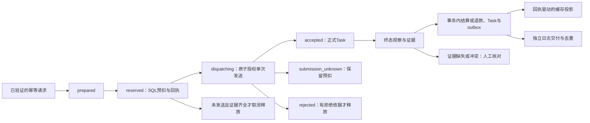

# P2-A1 增量结构审查（2026-11-07）

基线：dev / `f46f19c71dbf6954620feb43c01b8d8aa87bb1d5`。本文接续原 architecture-review.md。首批核对Lite支付回调、仅外部登录账户的访问能力；第二批基线dev/`4e42f4939422e8a7f04de4f6f50ce102dd77ed21`，接续异步任务恢复与账务衔接，具体覆盖见各节。主代理只读源码，没有运行行为测试、访问生产、查询真实账户或订单，也没有发送邮件、支付或模型请求。下表均为**从代码看**，不是新运行回归的结论。

## 本次结论

Full→Lite 不能当作普通镜像更新直接执行：回调路径会改变可达性，无密码账户也可能失去下一次登录入口。当前 Full→Full 的 beta.34→beta.36 打包不改变 edition，不需要为它扩大为降级修复。签名校验、资金 mode/epoch 与订单匹配仍必须保留，不能为恢复回调可达性而删门禁。

| ID | 从代码看 | 直接依据（本轮已读对应段落） | 影响与后续验收 |
| --- | --- | --- | --- |
| A1-01 | EditionGuard 在业务路由注册之前安装；Full 直接继续，Lite/lan 按路径阻断 | `main.go:203`、`middleware/edition.go:88` | 本文 Lite 路径结论不应推成 Full 当前线上失败；真实线上行为未测 |
| A1-02 | Stripe、Creem、Waffo webhook、Epay 充值 notify 和订阅 notify/return 被 Lite 前缀匹配提前返回403；签名及订单处理器还未执行 | `middleware/edition.go:131`、`:163`；`router/api-router.go:78`、`:98`、`:213` | 有未完成订单时直接降级可能切断履约；待合成真实路由回归，不联系供应商或重放现有通知 |
| A1-03 | `/api/waffo-pancake/webhook/:env` 不匹配 `/api/waffo` 加斜杠的前缀规则，且没有独立 Pancake 项；其可达性与其他提供方不同 | `router/api-router.go:83`、`middleware/edition.go:142`、`:163` | 这是版本路径差异，不能据此声称无签名可充值或直接封掉已付订单；下一轮统一降级策略后再决定处理方式 |
| A1-04 | Pancake 处理器仍检查test/prod、已配置签名、事件mode/type，再做资金决策；结算仍按订单种类分别处理 | `controller/topup_waffo_pancake.go:465`、`:476`、`:482`、`:487`、`:541` | 不把路径差异写成资金授权绕过；这些门禁必须由后续合成回归保持 |
| A1-05 | 资金策略与 edition 是不同维度；disabled 确认但不结算，retirement 只允许截止 epoch/ID 内历史订单，enabled 仍要求提供方、pending状态和epoch匹配 | `service/user_funding_policy.go:28`、`:74`；`model/user_funding_policy.go:381`、`:402` | 仅放行HTTP路径不足以证明会入账；也不能因禁购买而把retirement改成disabled、清空订单或放宽资金校验 |
| A1-06 | 订阅/充值的资金决策会在事务中重新校验，订阅订单使用跨库lockForUpdate并校验支付提供方与状态 | `model/subscription.go:632`、`:645`、`:651`、`:660`；`model/topup.go:326`、`:332`、`:341` | 后续 A2 必须保事务、状态、幂等及精确单次入账；本轮未审完整个结算子系统，不声称三库新行为已验 |
| A1-07 | 外部OAuth新用户从空User开始，不填密码；InsertWithTx允许空密码，插入默认设置及初始额度，不自动生成本地登录密码 | `controller/oauth.go:292`、`:333`、`:370`；`model/user.go:665`、`:674`、`:775`、`:132`；`model/credit_edge.go:100` | 无密码账户是实际支持的创建路径；不能假定每个外部登录用户已有本地凭据 |
| A1-08 | Lite封 `/api/oauth`；密码登录虽可达，还受PasswordLoginEnabled控制，空存储密码明确拒绝 | `middleware/edition.go:139`；`router/api-router.go:66`、`:75`、`:94`；`controller/user.go:40`；`model/user.go:1105`、`:1125` | 缺本地密码及可用Passkey时，重新登录可能不可达。此结论不表示现有会话立即失效；本轮未审所有会话续期路径 |
| A1-09 | Passkey登录不在Lite禁止前缀中，但需要开关/WebAuthn环境及已注册凭据；有API路径不能证明用户实际拥有可用凭据 | `router/api-router.go:95`；`controller/passkey.go:299`、`:309`、`:382`；`middleware/edition.go:131` | 降级前应实际确认所需账户的本地登录能力，不得仅以全局开关或凭据条数替代用户能登录的证明；浏览器/认证器未验 |
| A1-10 | 个人改密检查会拒绝旧密码为空；邮箱重置另有保留路径，通过唯一邮箱与重置码更新密码并撤销会话 | `controller/user.go:923`、`:934`；`router/api-router.go:63`、`:64`；`controller/misc.go:301`、`:334`；`model/user.go:1253` | 不能笼统建议无密码用户“在个人资料直接设密码”，也不能说邮箱恢复不存在；邮件投递、邮箱唯一性、密码登录开关及恢复后登录仍须确认，未发邮件 |
| A1-11 | CLI升级以已有.env中的edition选镜像并校验配置；该计划构造没有检查数据库pending订单或逐账户凭据。安装器既有保护主要核对目标身份和batch配置；受限运维服务仅支持Full | `cli/myapi.mjs:1183`、`:1190`、`:1197`；`deploy/install.sh:303`、`:314`；`tools/operations/docker.mjs:86` | 不把P1来源预检当作Full→Lite业务降级预检。受限运维服务不应扩展为Lite切换，本次也不安装它 |

## 第二批：异步任务恢复与账务衔接（2026-11-07，只读）

成功标准：把真实HTTP入口、系统任务调度、预扣/发送/终态、资金回执、缓存投影和日志交付串起来，区分已核对机制与待复现问题。验证方法：主代理亲读以下实现与调用点；本批只改文档，不新建行为测试，不将基线CI或文档CI当作新反例已复现。未调用生产、模型、供应商或恢复/重放入口。

### 状态与责任边界（均从代码看）

此图只表达本批已追踪的主要分支，不是完整状态机；未知状态的后续provider_verified/manual_audit解析、旧版非durable路径仍有独立条件。恢复SQL/日志投影不等于重新发送上游模型请求。

| ID | 从代码看 | 本轮亲读依据 | 结论的边界 |
| --- | --- | --- | --- |
| A1-12 | durable HTTP入口需要新提交开关、受支持的任务种类及幂等头，其他请求仍可走原任务路径 | `controller/relay.go:632`；`controller/relay_task_durable.go:26` | 不能把durable保护宣称成全部异步任务默认都有；本轮未逐个审完provider适配器 |
| A1-13 | 规范幂等头只接受单值、可打印有界ASCII；别名/下划线变体拒绝，hash后去掉原头。意图以Token/方法/种类/hash唯一化；重复owner=false直接返回旧操作，不再进发送pipeline | `service/task_submission_protocol.go:49`、`:109`；`service/task_ingress_service.go:150`、`:189`、`:208`；`model/task_recovery.go:651`、`:1190` | 正文fingerprint计算器只追到调用点，本轮未完整审JSON/表单/多媒体规范化，不能代替碰撞/等价性审查 |
| A1-14 | 新提交与已有义务恢复独立开关，schema兼容始终开启；开启任一运行能力要求专用幂等secret及DB单例身份；已有operation但身份缺失时不自动重绑 | `common/init.go:153`、`:165`；`common/constants.go:175`、`:182`、`:195`；`model/main.go:194`；`model/task_recovery_identity.go:50` | 不改现网开关、secret或identity，不以换配置重建历史幂等身份；未核对真实部署值 |
| A1-15 | main注册controller handlers后启动Master系统任务；恢复与日志outbox分别注册，由Enabled决定是否排新周期行，系统任务租约/heartbeat处理claim和失联 | `main.go:161`、`:163`；`controller/system_task_handlers.go:24`、`:343`、`:384`；`service/system_task.go:138`、`:279`、`:320`、`:369` | 已找到实际调用，不能因runner不在service里直接调用就判“没有接线”；排队后gate复核仍见R1 |
| A1-16 | pipeline拒绝外部已开事务；T1预扣、T2状态授权、实际dispatcher（事务外）、T3结果分开；accepted创建正式Task并关联，rejected释放，unknown/取消保留预扣 | `service/task_submission_service.go:92`、`:177`、`:201`、`:227`、`:267`、`:307`、`:341` | 出站已发生但本地写入失败不能回到“未发送”并自动重试；Task创建失败单独标unknown，其他错误要留待恢复 |
| A1-17 | operation与唯一attempt同时CAS到dispatching，使用同一DB时间；通用transition禁止单独进入dispatching。嵌套原子helper以savepoint保护，rollback失败则尝试使外事务不可提交 | `model/task_recovery.go:736`、`:840`、`:932`、`:1266` | SQLite不使用FOR UPDATE的共享规则仍在，不能仅凭源码声称多库并发已新验；不更改事务或锁顺序 |
| A1-18 | 过期dispatching在事务中转为submission_unknown；worker没有dispatcher调用，也不在该分支退款 | `service/task_recovery_worker.go:78`；`model/task_recovery_query.go:27` | 过期只表示结果未知，不能伪造成失败或零费用 |
| A1-19 | prepared可取消；reserved仅在attempt仍prepared且从未StartedAt、并有不可变reserve回执时尝试释放。缺统计证据进入manual记录，缺attempt/回执跳过并记日志 | `service/task_recovery_worker.go:167`、`:213`、`:240`；`model/quota_mutation_settle.go:60` | “释放超时预扣”不是无条件退款；已发送/未知必须保守处理 |
| A1-20 | polling先确认durable schema完整、绑定operation/attempt/reserve上下文；无终态依据、上下文错误或出现quota clamp时写manual observation，不直接按传入0结算 | `service/task_polling_context.go:47`、`:77`；`service/task_polling_bridge.go:46`、`:75`、`:130`；`model/task_terminal_observation.go:93` | 历史观察中的ActualQuota=0可以是manual占位，不能解读为上游确认零用量或已退款 |
| A1-21 | 应用终态验证provider evidence ID/version与attempt匹配，读取原reserve及已有receipt；同一事务处理资金、事件、receipt/outbox、正式Task、observation状态，失败回滚 | `model/task_terminal_observation.go:222`、`:263`、`:294`、`:332`；`model/quota_mutation_settle.go:60`、`:314` | 有证据字段不等于已独立访问供应商核验；本轮没有真实终态或数据库事务执行 |
| A1-22 | 预扣/退款/结算遵循User→Token→Subscription→Operation→Attempt锁顺序；校验所有者、版本、原始回执、互斥终态receipt和writer epoch。输入quota有MaxQuota边界，余额计算用CheckedQuota系列，异常转拒绝/人工核对 | `model/quota_mutation.go:329`、`:719`、`:1014`；`model/quota_mutation_settle.go:60`、`:314`、`:594`、`:704`、`:886` | 只审任务这条账务路径，不代表全部金额/订阅/账户账务均已逐文件审完；不放宽边界或“出错补零” |
| A1-23 | 经济事务内同时写不可变receipt、outbox和quota projection obligation；同步缓存投影在提交后执行，失败不会把上游请求再发送，后台依据持久化义务和epoch恢复投影 | `model/quota_mutation.go:661`、`:677`；`model/quota_mutation_settle.go:270`、`:547`；`model/quota_projection.go:422`、`:479`；`service/quota_projection_task.go:21` | service里忽略直接Project返回值不等于SQL扣费失败或无限重扣；也不证明缓存即时一致，恢复有gate/lease条件 |
| A1-24 | outbox认领/过期重领与完成都用state+lock_version，完成还要求worker与未过期lease；mutation层使用DB时钟，service扫描时的本机时钟fallback不替代mutation校验 | `service/task_billing_outbox_service.go:110`；`model/task_recovery.go:2764`、`:2836`、`:1979`、`:1993` | 不能仅因扫描有fallback就认定能越过数据库租约；真实时钟偏差/分库故障未测 |
| A1-25 | 日志投影按billing_event_id和不可变payload校验已有记录；ClickHouse有独立identity校验，冲突进入隔离。达到maxAttempts默认5后用长退避，仍可retry，不是丢弃记录 | `service/task_billing_outbox_service.go:194`、`:230`、`:259`、`:275`、`:295` | 日志交付和SQL经济事实是两步，不能为了日志重发模型/再扣费；逐条交付失败与批次状态差异见R2 |
| A1-26 | TaskOperation GET保持只读，SQL同时约束public ID/user和可选Token ID，仅投影状态/时间字段；查询不到与归属不符都不返回内部账务材料 | `router/task_operation-router.go:12`；`controller/task_operation.go:16`；`service/task_operation_query.go:18`；`model/task_operation_query.go:64` | 没有新增公开手动解析/退款路由；本轮没有完成所有TaskOperationAuth内部策略审查 |
| A1-27 | expiredBilling计数表示重领billing event lease，不等于新的账务已应用；terminal observation处理计数在RunRecoveryPass被丢弃，handler只报dispatch/unfinished/lease三项 | `service/task_recovery_worker.go:282`；`service/task_engine_runner.go:177`、`:182`；`controller/system_task_handlers.go:331`、`:363` | 不能用这个计数反推全部终态恢复/退款数，后续运维显示应分别取证，不直接扩大字段契约 |
| A1-28 | manual audit已有服务实现，用命令ID与reason/target等冲突校验并在事务中保留audit event/outbox；已读现有顺序冲突用例，但错误后的回查与初次读校验不同 | `service/task_resolution_service.go:387`、`:426`、`:475`、`:620`；`service/task_resolution_service_test.go:532` | 不能因只有GET路由就断言服务不存在，也不能把同命令ID都返回成功当幂等正确；并发候选见R3 |

### 三个待验证点（不是已复现故障，不改产品）

| ID | 源码首个差异与影响 | 最小后续合成证据 | 当前状态 |
| --- | --- | --- | --- |
| A1-R1 | Enabled只参与排新周期行；claim pass对已排队行不调用Enabled，taskRecoveryHandler.Run/taskBillingOutboxHandler.Run也未复核obligation gate。与logProjectionBackfillHandler.Run的gate-off直接no-op不同。存在gate关闭后旧排队行仍调用恢复/交付的可达路径 | Actions隔离DB中先在gate开时创建pending task，再模拟重启后新提交/义务gate都关，执行真实claim/handler链；精确断言业务表/日志无写入、无上游请求。保gate开时历史义务正常恢复对照；不得先删队列或禁用所有恢复制造绿 | 从代码看存在差异，未执行反例；未据此推断生产gate值或已发生越权写入。若维护者定义gate只停排新任务，应明确说明，不能静默改定义 |
| A1-R2 | ProcessClaimableBatch对单条claim DB错误继续，对交付错误保存retry/quarantine并继续，最终通常返回count,nil；系统handler据返回err标success。因此“本轮扫描成功”不等于“所有日志交付成功” | Actions隔离日志DB注入可控失败，核对SQL经济receipt不变、outbox保retry/隔离/下次时刻、无重复日志/扣费，再确认系统任务成功到底表示扫描完成还是全交付；先明确现有展示契约，再决定是否加结果分类/错误聚合 | 代码路径已读，未做故障注入；不能称已丢日志，也不能把count=0解释为没有义务或全部成功 |
| A1-R3 | manual audit首次读到同命令事件时比reason/owner/channel/终态；事务失败后的回查只比较AuditCommandID和manual_audit source，就可能返回现有结果。已读冲突测试是首次命令成功后再顺序调用，未覆盖该竞争分支 | Actions以确定性事务屏障使两个同命令不同reason请求的首次查询都未命中，先提交一个，再让另一个走错误回查；精确断言冲突返回、receipt/outbox唯一、余额仅变一次，补多库边界。不得用sleep/随机并发替代可复现顺序 | 从代码看校验分支不同，并发误接受仍待复现；未证明重复扣/退款或对外权限漏洞，不修产品/不放宽顺序冲突断言 |

### 本批覆盖记录与剩余范围

- 已完整读取：`service/task_engine_runner.go`、`service/task_recovery_worker.go`、`service/task_billing_outbox_service.go`、`service/task_submission_protocol.go`、`model/task_recovery_query.go`、`model/task_recovery_identity.go`及TaskOperation的controller/service/router小文件。
- 已按函数/片段读并追到直接调用：`common/init.go` gate解析、`common/constants.go` gate含义、`model/main.go`启动校验、`main.go`启动、`controller/relay.go`/`relay_task_durable.go`入口、`service/task_ingress_service.go`意图与replay、`task_submission_service.go`pipeline/accepted校验/unknown持久化、`controller/system_task_handlers.go`注册/recovery/outbox/backfill、`service/system_task.go`调度/claim/heartbeat、`model/system_task.go`claim/过期/finish、`model/task_recovery.go`意图/状态/dispatch/savepoint/lease/outbox校验、`task_terminal_observation.go`创建/应用、`quota_mutation.go`预扣/输入与余额边界、`quota_mutation_settle.go`退款/结算/证据与余额边界、`service/task_polling_context.go`schema/批量读、`task_polling_bridge.go`证据桥、`task_resolution_service.go`provider与manual分支、`quota_projection.go`回执投影/义务扫描、`service/quota_projection_task.go`及`account_quota_refund_task.go`调度。
- 这里只标读过的实现，不把函数索引、文件名检索或某个测试标题当成完整文件审查。legacy polling/provider全分支、请求指纹所有形式、普通文本/用户/账户账务其余模块、完整quota projection/account事实内部、tools/website/deploy剩余资产仍待，**A1整体未完成**。
- 本轮没有新行为测试、行为修复、schema迁移、开关或生产变更。基线完整CI42259867386此前已亲读且本轮元数据仍success，只证明原门禁；本轮文档提交仍须读自己的完整CI，不能把其通过写成R1–R3已复现或已修复。

## 建议的最小后续顺序（尚未改产品）

1. 继续 A1 的账务/异步任务恢复与部署资产审查，复用本报告追加证据，不新建另一份总账。
2. A2 先给精确方案：对真正的 edition 降级做失败关闭的预检，明确未完成充值/订阅订单、账户本地登录能力和未知/失败状态；不自动取消订单、不替用户设密码、不删除OAuth绑定、不回放通知。
3. 合成回归须分开验证 edition、funding mode、合法签名、pending/已成功/错误提供方/过期epoch，以及有无本地凭据；Full既有路径与单次结算不变。所有实际构建测试只在 Actions，真实服务与浏览器另行授权。
4. 本报告只记录发现；在具体范围确认前，不修改支付回调白名单、认证方式、资金状态、数据库或升级器。Full→Full生产更新继续使用既有严格镜像身份、最新数据保全与配置保留流程。

## 覆盖与未验范围

- 本轮逐段读过：edition guard、全局挂载与API路由、Stripe/Creem/Waffo/Pancake/Epay处理器对应入口、统一funding决策与订单事务校验、OAuth创建、用户插入/密码校验/改密/邮箱恢复、Passkey登录、CLI计划/安装器预检及Full运维限制。
- **P2-A1整体未完成**：第二批已补异步恢复/任务账务主链及片段覆盖；账务与异步任务其余逐文件审查、`tools/`全目录、`website/`、`deploy/`全资产仍待。790个单调用点与637个翻译键是历史候选数，未在本轮重新测量或认定可删除。
- 只读审查没有新增行为测试，不将既有CI绿当作上述所有降级场景已验证。没有运行本机测试/浏览器/Docker或安装依赖，没有下载构建产物，没有查询生产账户/订单或调用供应商。
